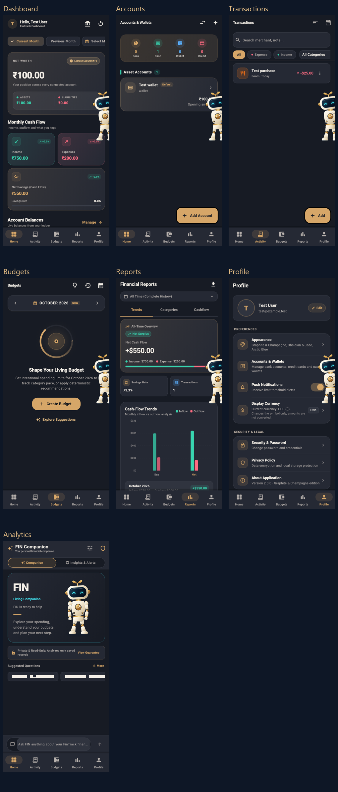
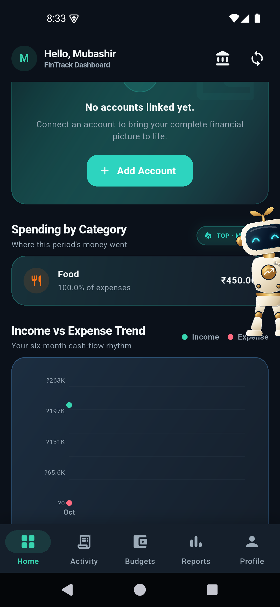
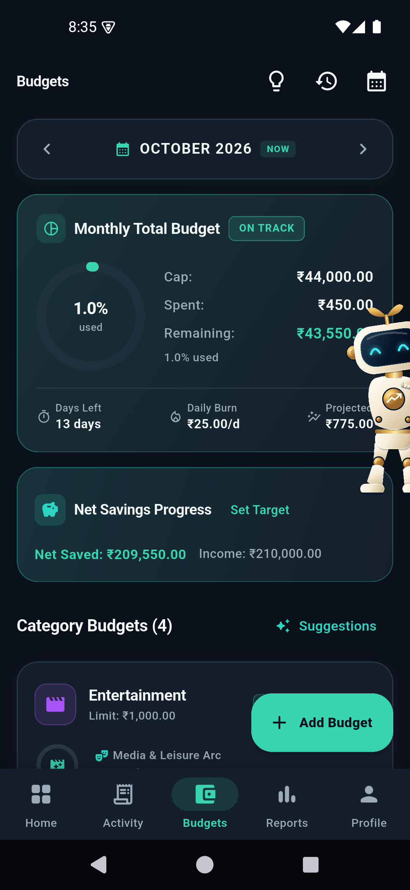
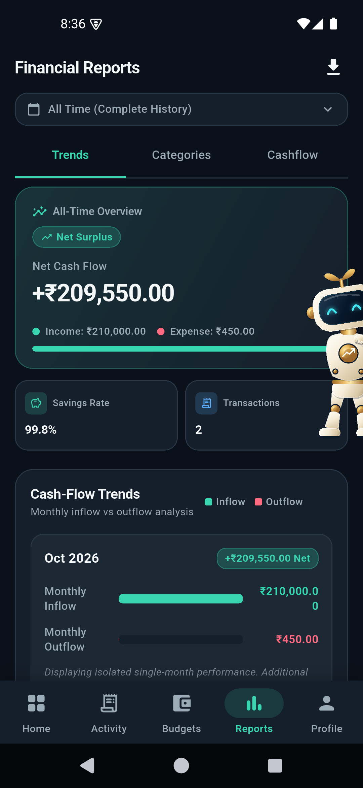
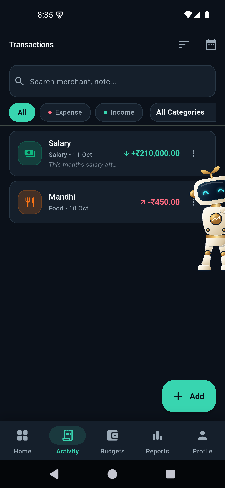
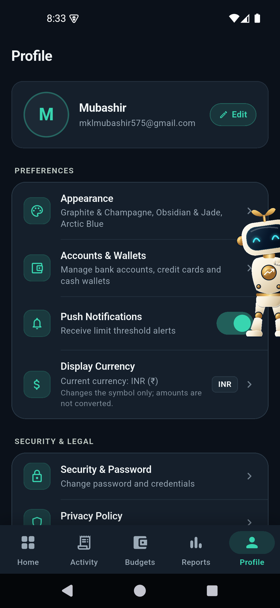
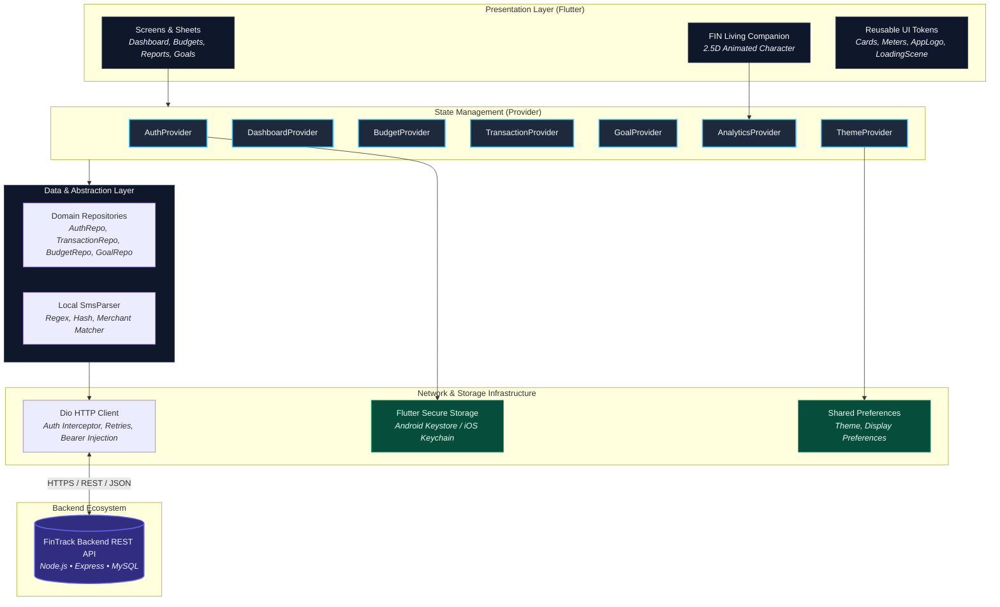

<p align="center">
  
</p>

<p align="center">
  
</p>

<h1 align="center">FinTrack 2.0</h1>

<p align="center">
  <strong>Intelligent Personal Finance Manager & Living Financial Companion</strong><br>
  <em>A high-performance Flutter mobile application engineered for precision wealth tracking, proactive budgeting, smart SMS ingestion, and privacy-first financial intelligence.</em>
</p>

<p align="center">
  
  
  
  
  
  
</p>

<p align="center">
  <a href="#-product-overview">Product Overview</a> •
  <a href="#-visual-showcase">Visual Showcase</a> •
  <a href="#-features--implementation-status">Features</a> •
  <a href="#-technical-architecture">Architecture</a> •
  <a href="#-fin--financial-intelligence-navigator">FIN Companion</a> •
  <a href="#-privacy--security-architecture">Privacy & Security</a> •
  <a href="#-getting-started">Getting Started</a> •
  <a href="#-backend-api-ecosystem">Backend API</a>
</p>

---

## 💡 Product Overview

Modern personal financial tracking is frequently undermined by friction: manual transaction entry causes fatigue, unbudgeted expenses slip past undetected, and generic financial dashboards offer backwards-looking metrics without actionable guidance.

**FinTrack 2.0** solves this through a cohesive, privacy-centric financial management client:

1. **Multi-Account Ledger**: Maintains synchronized tracking across liquid bank accounts, cash reserves, digital wallets, and credit cards with billing cycles.
2. **Semi-Automated Smart SMS Ingestion**: Parses incoming bank notification SMS locally on the device using pattern matching and hash deduplication, staging them as unconfirmed candidates for 1-tap review.
3. **Proactive Living Budgets**: Computes real-time spending burn rates, category allowances, and deterministic threshold alerts (`on_track`, `approaching_limit`, `exceeded`).
4. **FIN Living Financial Companion**: Embeds an expressive 2.5D character companion (**F.I.N. — Financial Intelligence Navigator**) that delivers deterministic natural-language explanations, what-if savings projections, and prioritized alerts—with strict privacy boundaries.
5. **Midnight Aurora Design System**: Provides a dark-first aesthetic across three bespoke theme collections (**Graphite & Champagne**, **Obsidian & Jade**, and **Arctic Blue**) paired with adaptive native launcher icon switching.

---

## 📱 Visual Showcase

FinTrack 2.0 is built around the **Midnight Aurora** design language—combining rich dark slate surfaces, glowing status accents, and high-contrast typography.

### Application Ecosystem Overview

<p align="center">
  
</p>

> [!NOTE]
> The complete screen suite above demonstrates (left to right, top to bottom): **Dashboard Overview**, **Accounts & Wallets**, **Transactions Ledger**, **Living Budgets**, **Financial Reports**, **Profile & Settings**, and the **FIN Financial Intelligence Companion**. A corresponding light edition is available at `docs/screenshots/overview-light.png`.

### Core Application Views

| **Dashboard & Net Worth** | **Living Budgets & Burn Rate** | **Interactive Reports & Trends** |
| :---: | :---: | :---: |
|  |  |  |
| Real-time balance aggregation, cashflow trends, and persistent edge companion presence. | Dynamic category progress rings, daily burn-rate indicators, and 3-month smart suggestions. | Category distribution, inflow vs outflow bar charts powered by `fl_chart`, and PDF statement exports. |

| **Transactions Ledger** | **Profile & Appearance** | **FIN Living Companion** |
| :---: | :---: | :---: |
|  |  |  |
| Search, category filters, income/expense classification, and SMS-staged candidates. | Theme collection selection, currency display settings, security credentials, and app metadata. | Interactive dialogue, privacy guarantees, what-if savings planning, and action previews. |

---

## ✨ Features & Implementation Status

| Feature Domain | Implemented Functionality | Status |
| :--- | :--- | :---: |
| **Authentication & Session** | Email and password authentication; cryptographically signed JWT sessions; automatic silent restoration; secure hardware-backed storage (`flutter_secure_storage`). | ✅ Complete |
| **Account & Wallet Management** | Multi-account support across Asset (Bank, Cash, Digital Wallet) and Liability (Credit Card) accounts; credit card billing cycle tracking (statement day, due day); balance adjustments. | ✅ Complete |
| **Transactions Ledger** | Income and expense recording; search by merchant/note; category tagging; account association; pagination; soft deletion; ledger balance reconciliation. | ✅ Complete |
| **Smart SMS Ingestion** | Local on-device SMS parsing via regex; SHA-256 hash deduplication; merchant normalization; category auto-detection; staged review workflow (`suggested` → `confirmed` / `rejected`). | ✅ Complete |
| **Living Budgets** | Monthly budget caps per category; real-time spending progress meters; threshold alerts (`on_track`, `approaching_limit` at 80%, `exceeded` at 100%); daily burn-rate run rates. | ✅ Complete |
| **Reports & Analytics** | Period cash-flow summaries; category breakdown donuts; chronological inflow/outflow charts; automated monthly PDF statement generation via `pdf`. | ✅ Complete |
| **FIN Financial Companion** | Expressive 2.5D living character; 10 distinct emotional states; floating edge presence; deterministic question answering; proactive anomaly notifications; allowlisted action confirmations. | ✅ Complete |
| **Savings Goals & Forecasting** | Target goal creation with deadlines; allocation contributions; deterministic cash flow forecasting; what-if simulation engine without database mutations. | ✅ Complete |
| **Theme & Adaptive Branding** | Midnight Aurora design tokens; 3 theme collections (Graphite & Champagne, Obsidian & Jade, Arctic Blue); runtime Android launcher icon dynamic switching. | ✅ Complete |
| **Connectivity & Secure Offline Cache** | Network monitoring (`connectivity_plus`); encrypted native response caching (`flutter_secure_storage`) with fail-closed guarantee; memory-only web caches; offline banner indicators. | ✅ Complete |
| **Profile, Privacy & Deletion** | In-app profile updates; password change with global session invalidation; two-step confirmed account and data deletion; technical privacy notice and permission recovery. | ✅ Complete |
| **Multi-Currency Conversion** | Display currency symbol formatting. *(Live exchange rate conversion across foreign currencies is planned).* | 🟡 Partial |

---

## 🏗️ Technical Architecture

FinTrack follows a **Layered Feature Architecture** paired with the **Repository Pattern** and **Provider** state management. UI widgets subscribe to business logic providers, which delegate data fetching to domain repositories and an authenticated HTTP client.

### Architectural Data Flow



### Key Technical Decisions

- **State Management**: Implemented using `provider` and `ChangeNotifier` to ensure reactive UI updates without framework overhead.
- **Networking**: `dio` client configured with an authorization interceptor that injects Bearer JWT tokens, handles automated session expiration (`401` detection), and safely retries transient read requests.
- **Local Security**: Session tokens are isolated within hardware-backed security modules (`EncryptedSharedPreferences` on Android via Keystore, and Keychain Services on iOS).
- **Navigation**: Structured declarative routing managed by `go_router` with redirect guards protecting authenticated views from unauthenticated access.

---

## 🤖 FIN — Financial Intelligence Navigator

**F.I.N.** (*Financial Intelligence Navigator*, *"Your personal financial companion."*) is FinTrack's living companion character. Unlike generic chat interfaces, FIN is character-driven, highly expressive, and mathematically deterministic.

```
       ▲  ▲
      ( • ‿ • )   "Your savings rate improved by 4.2% this month!
     /|  ₹  |\     You have ₹43,550 remaining in your budget."
      |_____|
       d   b
```

### Character & Assistance Capabilities

1. **Adaptive Visual States**: FIN renders in 10 expressive emotional and operational states (`idle`, `thinking`, `happy`, `warning`, `celebrating`, `confused`, `saving`, `calculating`, `peeking`, `sleeping`) reacting to user interaction and financial milestones.
2. **Deterministic Financial Analysis**: When a user asks about their spending, budgets, or savings, FIN queries authenticated backend endpoints that compute exact sums, percentages, and deltas using integer-minor-unit arithmetic. Zero numbers are hallucinated.
3. **Proactive Intelligence**: Continuously evaluates category spending against elapsed monthly days, surfacing contextual notifications when a budget approaches 80% or exceeds 100%.
4. **Interactive Action Confirmation**: When assisting with savings planning (e.g. creating a goal), FIN generates a structured preview card detailing parameters and real-world impact. Mutating actions require explicit user confirmation.

---

## 🛡️ Privacy & Security Architecture

FinTrack is engineered around strict, non-negotiable data boundaries:

> [!IMPORTANT]
> **FinTrack Privacy Invariants**:
> 1. **No External AI Transmission**: Sensitive financial records (amounts, balances, account numbers, merchants) are **never** transmitted to external language model APIs (such as OpenAI, Anthropic, or external cloud LLMs). All financial calculations are executed on trusted backend infrastructure.
> 2. **No Autonomous Bank Egress**: FinTrack does not connect to external banking aggregators or scrapers. Records are derived solely from user entries and user-authorized SMS imports.
> 3. **Device SMS Isolation & Explicit Consent**: The SMS parser operates strictly on the local device. Scanning requires explicit user disclosure and consent with the option to decline. Raw SMS bodies are never uploaded to the backend without explicit user selection, and unconfirmed candidates in `detected_transactions` are excluded from analytics calculations.
> 4. **Tenant Isolation**: Every API request derives account identity strictly from the cryptographically verified JWT payload. Client-provided user IDs are discarded.
> 5. **Log Redaction**: Sensitive fields (passwords, tokens, financial amounts, search queries) are redacted from diagnostic logs to prevent storage leakage.
> 6. **Encrypted Native Caching & Volatile Web Caching**: Financial response caches on native devices are encrypted using `FlutterSecureStorage` (fail-closed, 24-hour expiration), while web clients retain caches strictly in volatile memory.
> 7. **Account & Data Deletion**: Users can permanently delete their account and associated data from within the app (with two-step confirmation and password re-verification) or via an external web portal.

---

## 📂 Project Structure

```
frontend/
├── android/                   # Native Android host & dynamic launcher icon aliases
├── assets/                    # Static assets & documentation banners
│   ├── branding/              # Approved FinTrack 2.0 theme logos (Graphite, Jade, Arctic)
│   └── readme_banner.png      # High-resolution documentation banner
├── docs/                      # Documentation assets & screenshots
│   └── screenshots/           # Verified application previews (dark & light suites)
├── ios/                       # Native iOS host configuration & assets
├── lib/
│   ├── api/                   # HTTP client, auth interceptors, and endpoint constants
│   ├── core/                  # Architecture foundations
│   │   ├── constants/         # API routes, color palettes, spacing tokens
│   │   ├── services/          # Token service, native launcher icon channel
│   │   ├── theme/             # Midnight Aurora design tokens & theme collections
│   │   ├── utils/             # SMS parser, merchant normalizer, PDF generator
│   │   └── widgets/           # AppLogo, FinTrackLoadingScene, CustomToast
│   ├── models/                # Strongly typed domain data models
│   ├── providers/             # ChangeNotifier state providers (Auth, Budget, Dashboard, FIN)
│   ├── repositories/          # Domain data retrieval & persistence layers
│   ├── routes/                # GoRouter declarative navigation hierarchy
│   ├── screens/               # Feature UI screens
│   │   ├── accounts/          # Account & wallet management views
│   │   ├── analytics/         # FIN companion screen & insights feed
│   │   ├── auth/              # Login & registration screens
│   │   ├── budgets/           # Living budgets, burn rates & category cards
│   │   ├── dashboard/         # Aggregated overview & net worth
│   │   ├── planning/          # Goals tracker & what-if cashflow simulation
│   │   ├── profile/           # Theme picker, currency settings, security
│   │   ├── reports/           # Financial trends, category donuts, PDF export
│   │   ├── splash/            # Animated startup loading scene & session check
│   │   ├── transactions/      # Ledger views, search, and SMS review
│   │   └── transfers/         # Account-to-account transfer forms
│   └── main.dart              # Application entrypoint & multi-provider wiring
├── test/                      # Comprehensive unit, widget, and visual regression tests
├── pubspec.yaml               # Flutter package dependencies & asset declarations
└── flutter_launcher_icons.yaml# App icon generation configuration
```

---

## 🚀 Getting Started

### 📋 Prerequisites

Ensure your development environment meets the following requirements:

- **Flutter SDK**: `^3.12.2` ([Installation Guide](https://docs.flutter.dev/get-started/install))
- **Dart SDK**: `^3.x` (bundled with Flutter)
- **Java Development Kit (JDK)**: OpenJDK 17 or 21 (for Android builds)
- **Android Studio / Xcode**: For emulator configuration and device toolchains
- **FinTrack Backend API**: A running local or hosted instance of the [FinTrack Backend API](https://github.com/Mubashir-114/expense-manager-api)

### 🛠️ Installation & Execution

1. **Clone the repository**:
   ```bash
   git clone https://github.com/Mubashir-114/budgetbee-app.git fintrack-frontend
   cd fintrack-frontend
   ```

2. **Install Flutter dependencies**:
   ```bash
   flutter pub get
   ```

3. **Configure the Backend API endpoint**:
   FinTrack uses compile-time `--dart-define` variables. In debug mode, it connects automatically to local backends (`http://10.0.2.2:5000/api/` for Android Emulators, `http://127.0.0.1:5000/api/` for desktop/web).

   To target a custom endpoint explicitly:
   ```bash
   # Android Emulator targeting local machine
   flutter run --dart-define=BASE_URL=http://10.0.2.2:5000/api/

   # Local Desktop or Web targeting localhost
   flutter run --dart-define=BASE_URL=http://127.0.0.1:5000/api/
   ```

4. **Run automated test suites**:
   ```bash
   # Executes comprehensive suite (302 passed, 1 expected integration skip, 0 failed)
   flutter test

   # Codebase static analysis (verified clean, 0 issues)
   flutter analyze
   ```

5. **Build release APK (Android)**:
   ```bash
   flutter build apk --release --dart-define=BASE_URL=https://your-api-endpoint.com/api/
   ```

---

## 🎨 Theme Collections

FinTrack 2.0 features three distinct theme aesthetics within the Midnight Aurora design system. Switching themes in the Profile screen updates all UI components and synchronizes the native Android home-screen launcher icon:

| Theme Collection | Primary Tone | Accent Highlight | Personality |
| :--- | :--- | :--- | :--- |
| **Graphite & Champagne** *(Default)* | Deep Onyx Slate | Warm Champagne Gold | Executive, refined, timeless |
| **Obsidian & Jade** | Obsidian Black | Emerald Mint Green | Modern, vibrant, growth-focused |
| **Arctic Blue** | Midnight Navy | Electric Arctic Cyan | Tech-forward, crisp, analytical |

---

## 🗺️ Roadmap & Development Status

### Phase 1–5E.1 (Completed)
- [x] Multi-tenant JWT authentication and session persistence
- [x] Asset accounts (Bank, Cash, Wallets) and Credit Card management
- [x] Atomic fund transfers and double-entry adjustments
- [x] Staged smart SMS transaction detection and merchant normalization
- [x] Real-time category budget caps, threshold alerts, and burn-rate tracking
- [x] Deterministic savings goals planner and what-if cashflow simulations
- [x] FIN Living Companion with 10 visual states and deterministic analytics
- [x] Midnight Aurora design system with 3 adaptive themes and launcher icon sync
- [x] PDF statement generation and financial export

### Future Enhancements
- [ ] Multi-currency conversion engine with historical exchange rate tracking
- [ ] Recurring subscription and bill payment calendar reminders
- [ ] Biometric authentication (Fingerprint / Face ID lock)
- [ ] Cross-platform desktop keyboard shortcut navigation

---

## 🔗 Backend API Ecosystem

The FinTrack Flutter client communicates with the **FinTrack Backend REST API**, a high-performance Express and MySQL service providing multi-tenant ledger management, mathematical analytics, and privacy egress firewalls.

- **Repository**: [FinTrack Backend API](https://github.com/Mubashir-114/expense-manager-api)
- **Documentation**: Refer to the [Backend Documentation](https://github.com/Mubashir-114/expense-manager-api/blob/main/README.md) for database migration schemas, environment setup, and OpenAPI endpoint references.

---

## 📄 License & Maintainer

FinTrack 2.0 is an engineering project developed and maintained by **Mubashir** ([@Mubashir-114](https://github.com/Mubashir-114)).

Distributed under the **ISC License**. See the repository license file for terms.
