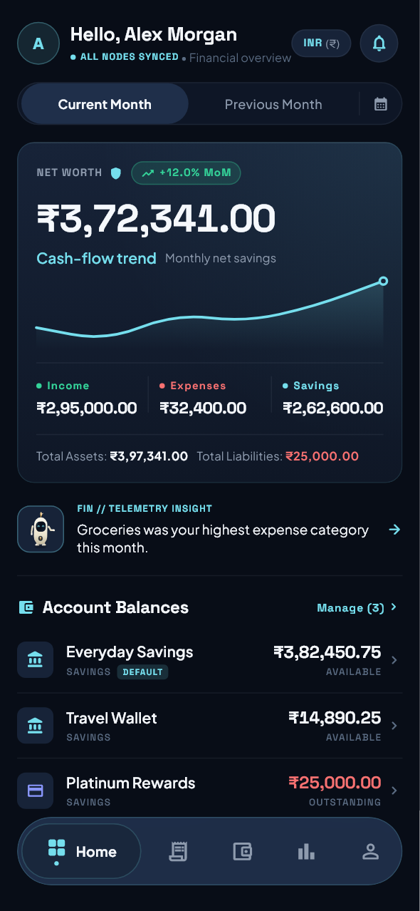
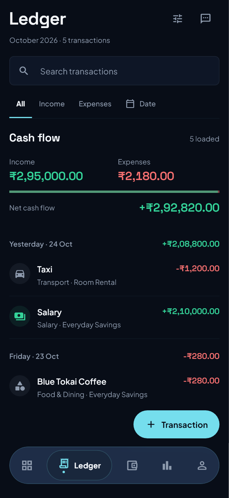
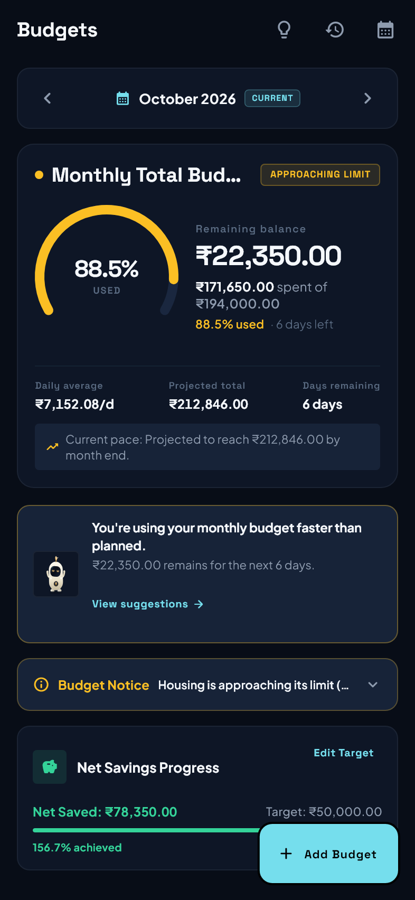
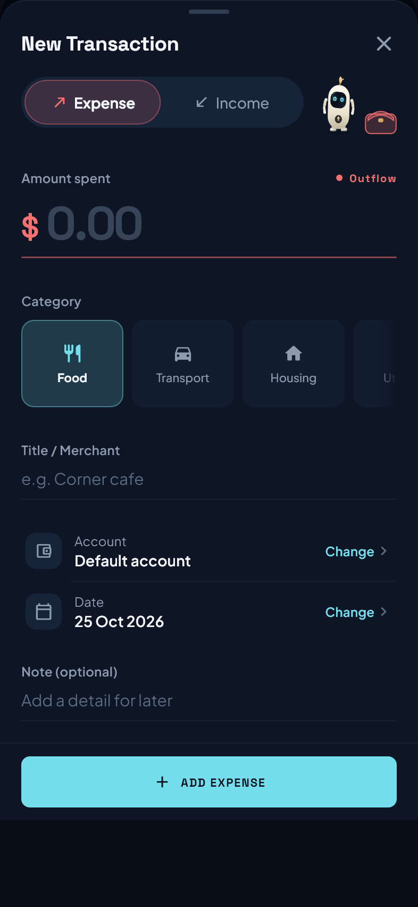
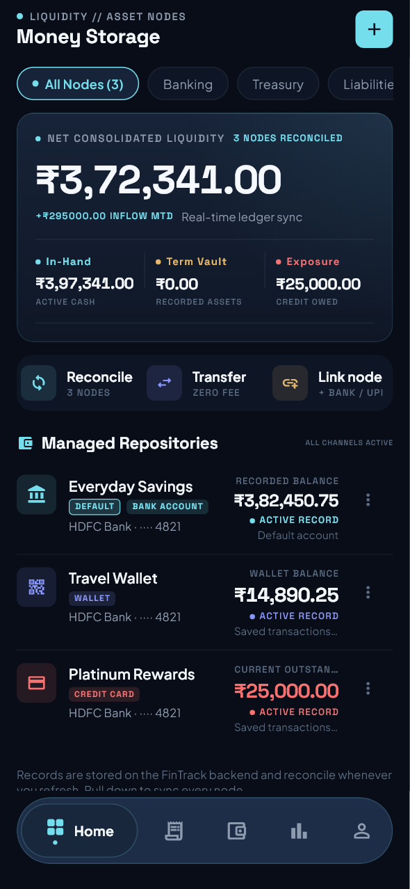
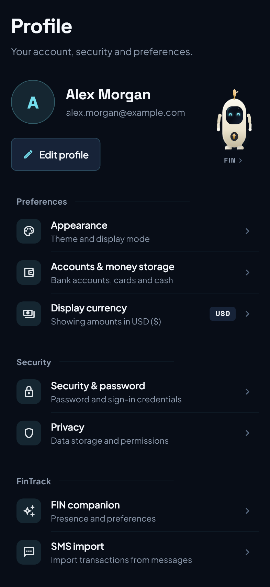
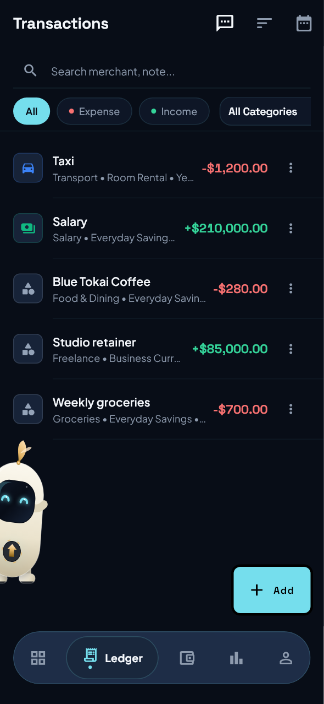
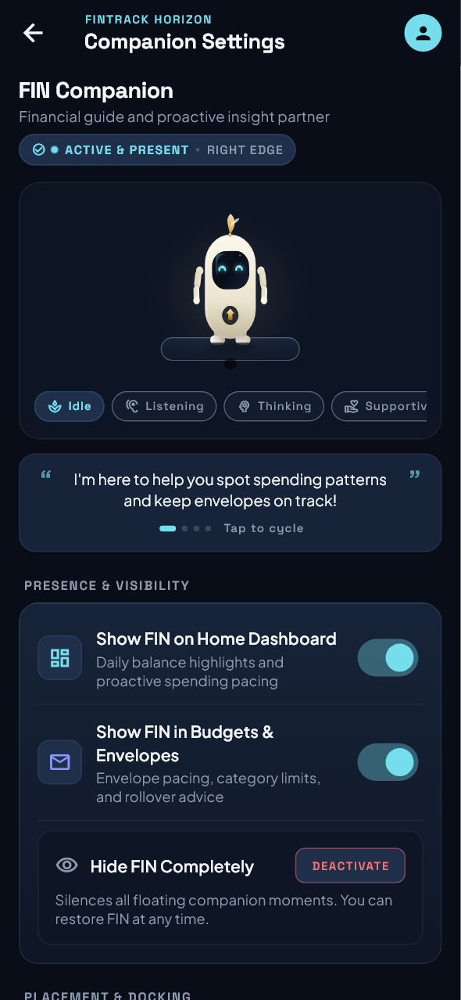
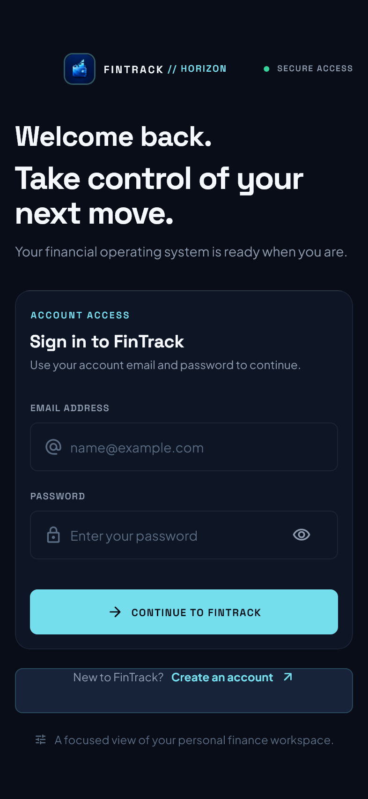
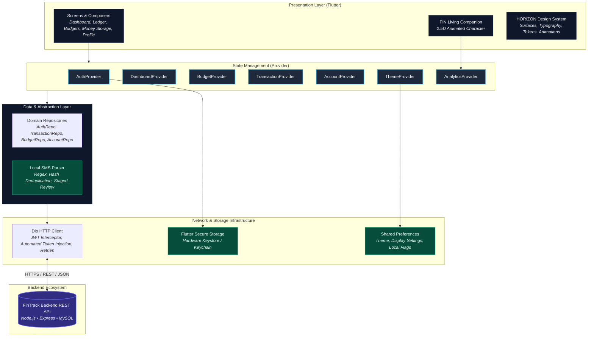

<p align="center">
  
</p>

<p align="center">
  
</p>

<h1 align="center">FinTrack // HORIZON</h1>

<p align="center">
  <strong>Intelligent Personal Finance Manager & Living Financial Companion</strong><br>
  <em>A finance-first Flutter experience engineered for editorial hierarchy, precision wealth tracking, proactive budgeting, user-controlled SMS ingestion, and privacy-bounded financial intelligence.</em>
</p>

<p align="center">
  
  
  
  
  
  
</p>

<p align="center">
  <a href="#-product-overview">Product Overview</a> •
  <a href="#-visual-showcase">Visual Showcase</a> •
  <a href="#-core-features--screen-architecture">Features</a> •
  <a href="#-six-curated-theme-collections">Theme Collections</a> •
  <a href="#-fin--financial-intelligence-navigator">FIN Companion</a> •
  <a href="#-privacy--security-architecture">Privacy & Security</a> •
  <a href="#-technical-architecture">Architecture</a> •
  <a href="#-getting-started">Getting Started</a> •
  <a href="#-backend-api-ecosystem">Backend API</a>
</p>

---

## 💡 Product Overview

Modern personal financial tracking is frequently undermined by friction: manual transaction entry causes fatigue, unbudgeted expenses slip past undetected, and generic financial dashboards offer backwards-looking metrics without actionable guidance.

**FinTrack // HORIZON** (FinTrack 2.0) introduces an open, typography-driven financial design system and private intelligence layer:

- **Editorial Financial Hierarchy**: Replaces heavy card containers with open typographic layouts, clean hairline rules, and high scannability.
- **Reduced Card Density & Semantic Surfaces**: Surfaces data on deliberate visual levels with clear figure contrast.
- **Animated Financial Data**: Dynamic count-up value transitions and trend lines bring financial deltas into focus.
- **Living FIN Companion Integration**: Contextual guidance from FIN (*Financial Intelligence Navigator*) operating strictly within local privacy boundaries.
- **Responsive Layout Matrix**: Proportional scaling and adaptive layouts engineered across form factors from 320dp compact phones to wide displays.
- **Six Curated Theme Collections**: Seamless switching across six financial aesthetics with Android launcher icon synchronization for release builds.

---

## 📱 Visual Showcase

### Product Preview

<p align="center">
  
</p>

### Core Application Views

| **Dashboard** | **Ledger** | **Budgets** |
| :---: | :---: | :---: |
|  |  |  |
| Real-time net worth, cash flow visualization, account summaries, and live notifications. | Modern statement-style transaction journal with quick filters, search, and cash flow summary. | Monthly budget hero, animated budget arc, category progress, projections, and FIN insight. |

| **Add Transaction** | **Money Storage** | **Profile** |
| :---: | :---: | :---: |
|  |  |  |
| Amount-first composer with category selector, default account selection, and FIN purse flow. | Compact liquidity presentation, account nodes, default account routing, and transfers. | Editorial identity hero, avatar support, appearance settings, and FIN companion controls. |

| **Transactions** | **FIN Companion** | **Authentication** |
| :---: | :---: | :---: |
|  |  |  |
| Flattened transaction rows with search/filter rail, edit/delete actions, and SMS import access. | Dedicated companion hub, live pose preview, guidance style, and strict data boundaries. | Clean HORIZON authentication experience with responsive layout and input validation. |

---

## ✨ Core Features & Screen Architecture

### 1. Authentication & Onboarding
- Premium HORIZON sign-in and sign-up experience with responsive composition.
- Cryptographically signed JWT session management with automated silent token restoration.
- Secure hardware-backed credential storage via `flutter_secure_storage`.

### 2. Dashboard
- Aggregated net-worth overview with live total balance and periodic comparison.
- Visual cash-flow analysis showcasing monthly inflows, outflows, and net savings rate.
- Quick account balances carousel with liquidity health indicators.
- Category spending distribution with interactive range selection.
- Recent transactions feed and functional Updates & Notification Center sheet.
- Contextual FIN companion insights and animated count-up numbers.

### 3. Ledger & Transactions
- Modern statement-style transaction rows organized chronologically with calendar headers.
- Open summary band displaying period cash flow and proportional inflow/outflow bars.
- Instant search by merchant, description, or notes, paired with transaction type filters.
- In-place transaction editing, category re-assignment, and soft-delete capabilities.
- Staged SMS transaction review access for user-approved ingestion.

### 4. Add Transaction Composer
- Amount-first composer designed for rapid single-handed entry.
- Category picker with intuitive icons and automatic color coding.
- Dynamic account selection with default payment account auto-selection.
- Interactive FIN purse animation reflecting money flowing into the ledger.

### 5. Money Storage (Accounts & Liquidity)
- Unified account hub tracking bank accounts, liquid cash, digital wallets, and credit cards.
- Compact liquidity presentation highlighting available funds vs. pending liabilities.
- Primary default account designation for incoming transaction assignment and SMS routing.
- Streamlined account-to-account transfer and reconciliation workflows.

### 6. Budgets & Spending Guidance
- Monthly budget hero featuring the signature HORIZON animated budget arc.
- Category budget progress meters with deterministic threshold badges (`On Track`, `Approaching Limit`, `Exceeded`).
- End-of-month spending projections calculated from real transaction pacing.
- Contextual FIN budget insights offering tailored spending advice.
- Dedicated Add Budget composer for rapid category allocation.

### 7. Profile & Preferences
- Clean editorial identity header displaying account metadata and custom avatars.
- Theme collection selector with instant real-time theme previews.
- Currency display formatting preferences.
- Security preferences including password updates and complete account deletion.
- Dedicated FIN Companion settings panel.

### 8. FIN Living Financial Companion
- Expressive 2.5D companion character with animated emotional states (`idle`, `thinking`, `happy`, `warning`, `celebrating`, `saving`, `peeking`).
- Floating edge presence, customizable dock positioning, and unobtrusive presentation.
- Guidance style preferences (supportive, analytical, minimal).
- Strict privacy boundary: analyzes only user-authorized financial records already stored within FinTrack.

---

## 🎨 Six Curated Theme Collections

FinTrack // HORIZON provides six curated theme collections designed for clarity, contrast, and visual refinement:

| Theme Collection | Key Visual Tones | Design Character |
| :--- | :--- | :--- |
| **Midnight Aurora** | Deep navy, ion cyan & electric indigo | Technical, nocturnal, focused |
| **Obsidian Jade** | Charcoal black, emerald jade & soft teal | Organic, vibrant, growth-centered |
| **Graphite Champagne** *(Default)* | Elegant graphite, champagne & muted gold | Executive, refined, timeless |
| **Arctic Blue** | Cool white, ice blue & midnight blue | Crisp, analytical, high-contrast |
| **Ivory Sand** | Warm ivory, sandstone & bronze | Warm, editorial, balanced |
| **Amethyst Pulse** | Deep plum, soft violet & lavender | Creative, distinctive, modern |

> [!NOTE]
> On Android release builds, changing your theme collection can dynamically synchronize the native launcher icon on your home screen. In development and debug builds, dynamic switching is safely bypassed to preserve stable debugging workflows.

---

## 🛡️ Privacy & Security Architecture

FinTrack is engineered around uncompromising data boundaries:

> [!IMPORTANT]
> **FinTrack Privacy & Data Boundary Invariants**:
> 1. **No External LLM Transmission**: Private financial records (account numbers, balances, transactions, merchants) are **never** transmitted to third-party language models (such as OpenAI, Anthropic, or external cloud LLMs). All financial calculations and summaries are deterministic and computed inside trusted backend boundaries.
> 2. **No Autonomous Bank Scraping**: FinTrack does not connect autonomously to external banking scrapers or financial aggregators. Data originates strictly from user entry and explicit user-staged SMS imports.
> 3. **No Independent SMS Inbox Ingestion by FIN**: FIN does not autonomously read user SMS messages. SMS ingestion is an explicit, user-initiated on-device workflow where parsed items remain in an unconfirmed staging state until confirmed by the user.
> 4. **Tenant Isolation**: Every API request derives user identity exclusively from cryptographically validated JWT claims verified on the backend. Client-provided user IDs are discarded.
> 5. **Hardware-Backed Local Storage**: Sensitive auth tokens and encrypted caches are isolated within platform-native secure storage (`EncryptedSharedPreferences` via Android Keystore; Keychain Services on iOS).
> 6. **Diagnostic Log Redaction**: Sensitive data, tokens, and personally identifiable financial details are redacted from diagnostic logs to prevent accidental disk leakage.
> 7. **Permanent Account & Data Erasure**: Users can permanently erase their account and all associated records with two-step confirmation directly from the Profile screen.

---

## 🏗️ Technical Architecture

FinTrack follows a **Layered Feature Architecture** paired with the **Repository Pattern** and **Provider** state management.



---

## 📂 Project Structure

```
frontend/
├── android/                   # Native Android host & launcher activity configuration
├── assets/                    # Static typography & documentation branding assets
│   ├── branding/              # Theme logos (Graphite Champagne, Obsidian Jade, Arctic Blue)
│   ├── fonts/                 # Space Grotesk and Plus Jakarta Sans typefaces
│   └── readme_banner.png      # High-resolution documentation banner
├── docs/                      # Documentation & showcase assets
│   └── screenshots/           # Curated HORIZON visual showcase screenshots
├── lib/
│   ├── api/                   # HTTP client, auth interceptors, and API endpoints
│   ├── core/                  # Architecture foundations
│   │   ├── horizon/           # HORIZON design system tokens, surfaces & animation primitives
│   │   ├── services/          # Token service, native launcher icon channel, cache service
│   │   ├── theme/             # Six curated theme collections and theme providers
│   │   ├── utils/             # SMS parser, merchant normalizer, currency formatters
│   │   └── widgets/           # Notification center sheet, custom toast, shared components
│   ├── models/                # Strongly typed domain data models
│   ├── providers/             # ChangeNotifier state providers (Auth, Budget, Dashboard, FIN)
│   ├── repositories/          # Domain data retrieval and persistence layers
│   ├── routes/                # GoRouter declarative navigation hierarchy
│   ├── screens/               # Feature UI screens
│   │   ├── auth/              # HORIZON login & onboarding screens
│   │   ├── budgets/           # Monthly budget hero, animated arc & category cards
│   │   ├── dashboard/         # Aggregated overview, net worth & updates center
│   │   ├── ledger/            # Statement-style transaction workspace & cash flow summary
│   │   ├── money_storage/     # Unified account nodes, liquidity & transfer actions
│   │   ├── profile/           # Identity hero, theme switcher & FIN companion controls
│   │   ├── transactions/      # Amount-first composer & flattened transaction feed
│   │   └── transfers/         # Account-to-account transfer workflows
│   └── main.dart              # Application entrypoint & multi-provider wiring
├── test/                      # Comprehensive unit, widget, and visual regression suites
└── pubspec.yaml               # Flutter dependencies & asset declarations
```

---

## 🚀 Getting Started

### 📋 Prerequisites

- **Flutter SDK**: `^3.12.2` ([Installation Guide](https://docs.flutter.dev/get-started/install))
- **Dart SDK**: `^3.x` (bundled with Flutter)
- **Java Development Kit (JDK)**: OpenJDK 17 or 21 (for Android builds)
- **FinTrack Backend API**: A running instance of the [FinTrack Backend API](https://github.com/Mubashir-114/fintrack_backend)

### 🛠️ Installation & Execution

1. **Clone the repository**:
   ```bash
   git clone https://github.com/Mubashir-114/fintrack_app.git fintrack-frontend
   cd fintrack-frontend
   ```

2. **Install Flutter dependencies**:
   ```bash
   flutter pub get
   ```

3. **Configure the Backend API endpoint**:
   FinTrack uses compile-time `--dart-define` variables. In debug mode, it connects automatically to local backends (`http://10.0.2.2:5000/api/` for Android Emulators, `http://127.0.0.1:5000/api/` for desktop/web).

   To target a custom endpoint explicitly:
   ```bash
   # Android Emulator targeting host machine
   flutter run --dart-define=BASE_URL=http://10.0.2.2:5000/api/

   # Local Desktop or Web targeting localhost
   flutter run --dart-define=BASE_URL=http://127.0.0.1:5000/api/
   ```

4. **Run automated verification**:
   ```bash
   # Codebase static analysis (verified clean, 0 issues)
   flutter analyze

   # Run comprehensive regression suite (247 passing tests)
   flutter test
   ```

---

## 🔗 Backend API Ecosystem

The FinTrack Flutter client communicates with the **FinTrack Backend REST API**, an Express and MySQL service providing multi-tenant ledger management, deterministic analytics, and privacy egress firewalls.

- **Repository**: [FinTrack Backend API](https://github.com/Mubashir-114/fintrack_backend)
- **Documentation**: Refer to the Backend Documentation for database migration schemas, environment setup, and OpenAPI endpoint references.

---

## 📄 License & Maintainer

FinTrack is developed and maintained by **Mubashir** ([@Mubashir-114](https://github.com/Mubashir-114)).

Distributed under the **ISC License**. See the repository license file for terms.
